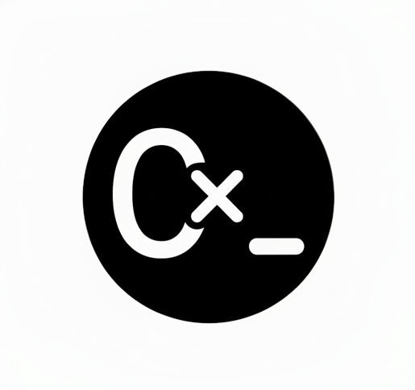

<p align="center">
  
</p>

<h1 align="center">TermOxide</h1>

<p align="center">A framework for building terminal user interfaces in Rust.</p>

## What TermOxide is

TermOxide lets you write a terminal user interface (TUI) the way you would write a modern web UI. You describe the interface as a tree of nodes and keep its state in reactive signals. When a signal changes, the framework redraws only the parts of the screen that depend on it.

- **Reactive:** state lives in signals. Reading a signal inside a view subscribes that view to it, and writing the signal schedules a redraw of everything that depends on it.
- **Declarative:** views are built with a node builder, or with the `rsx!` macro, instead of drawing cells by hand.
- **Styled:** a typed style value (colours, text attributes, borders, padding, flex layout) is resolved, inherited and laid out into terminal cells.
- **One loop:** the framework owns the terminal, the input thread and the input, update, build, render cycle, so your app only contains its own logic.

The terminal backend is [ratatui](https://ratatui.rs) on top of [crossterm](https://github.com/crossterm-rs/crossterm).

## How to run it

### Requirements

- Rust **stable**, installed with [rustup](https://rustup.rs). The workspace uses edition 2024.
- Rust **nightly**, for formatting only: `rustup toolchain install nightly`.
- Nix users can run `nix develop` instead: the flake provides the whole toolchain.

### Build and test

```sh
cargo build --workspace --all-features
cargo test --workspace --all-features
cargo doc --workspace --no-deps --all-features --open   # API docs
```

### Run a demo

```sh
cargo run --manifest-path demos/external_app/Cargo.toml         # keyboard
cargo run --manifest-path demos/external_app_mouse/Cargo.toml   # keyboard and mouse
```

Press `q` or `Ctrl+C` to quit.

### Use TermOxide in your app

Depend on the `termoxide` crate, then:

1. keep your state in `termoxide_reactive::Signal`;
2. build your view with `termoxide_rendering::builder`;
3. start everything with `termoxide::run_with_app`.

The apps in [`demos/`](demos) are small, complete examples to start from.

## How the project is organised

```text
Cargo.toml               the workspace: every crate below is a member
crates/
  termoxide              the entry point: run_with_app and the main loop
  termoxide_reactive     signals, effects and owners (the reactive core)
  termoxide_rendering    the view node tree, the render loop, buffer diffing and event routing
  termoxide_layout       the style value, inheritance, layers and layout
  termoxide_event        keyboard, mouse and resize events from the terminal
  termoxide_macros       procedural macros, such as rsx!
  termoxide_e2e          end to end tests through a real pseudo terminal
  cargo-extract          CI helper: lists the crates touched since a commit
demos/                   standalone example apps, each with its own Cargo.toml
assets/                  images used by the docs
.githooks/               pre-commit and commit-msg hooks
.github/                 CI workflows, issue and pull request templates
rustfmt.toml             formatting rules (some need nightly rustfmt)
flake.nix                Nix development shell
```

Data flows one way through the crates:

1. `termoxide_event` reads an event from the terminal;
2. the app updates a signal from `termoxide_reactive`;
3. `termoxide_rendering` rebuilds the views that read that signal;
4. `termoxide_layout` styles them and places them in cells;
5. only the cells that changed are written to the terminal.

## How to contribute

### 1. Set up once

```sh
sh .githooks/setup-hooks.sh     # Windows: .githooks/setup-hooks.ps1
```

The hooks check formatting, compilation and clippy before each commit, and the commit message format after it.

### 2. Pick or open an issue

Use the templates in [`.github/ISSUE_TEMPLATE`](.github/ISSUE_TEMPLATE). Every change should be linked to an issue.

### 3. Branch from `dev/trunk`

`dev/trunk` is the integration branch; `main` only receives work from it.

| Kind of change | Branch name | Example |
|---|---|---|
| Feature | `feat/<area>/<topic>` | `feat/style/arena` |
| Bug fix | `fix/<area>/<topic>` | `fix/event/resize` |
| Documentation | `docs/<topic>` | `docs/readme` |

### 4. Write the change

- Keep it small: one pull request does one thing.
- Put tests in `crates/<crate>/tests/*.rs` and test the public API.
- Avoid `unwrap`, `expect` and `panic!` in library code: return errors instead.
- Doc comments explain what the signature does not already say.

### 5. Check before you push

These are the same checks CI runs:

```sh
cargo +nightly fmt --all -- --check
cargo clippy --workspace --all-targets --all-features -- -D warnings
cargo test --workspace --all-features
```

### 6. Commit with the repo's message format

```text
<scope>: <imperative lowercase subject>
```

For example: `style: add cell geometry and the border box model`.

- The scope is the crate or area, in lowercase.
- The header is 72 characters at most and ends with a letter or a digit.
- The first word is imperative: `add`, not `added`, `adds` or `adding`.
- An optional body explains *why*, wrapped near 76 columns.
- A public API break gets a `BREAKING CHANGE:` footer.

### 7. Open a pull request

- Fill in the [pull request template](.github/pull_request_template.md).
- Link the issue with `Closes #N`, or `Part of #N` when several pull requests land one story.
- Keep the title equal to the commit header it will be squashed into.
- For work that builds on an open pull request, **stack** it: target that pull request's branch instead of `dev/trunk`, and retarget it once the lower one is merged.

## License

BSD 2-Clause, see [LICENSE](LICENSE).
